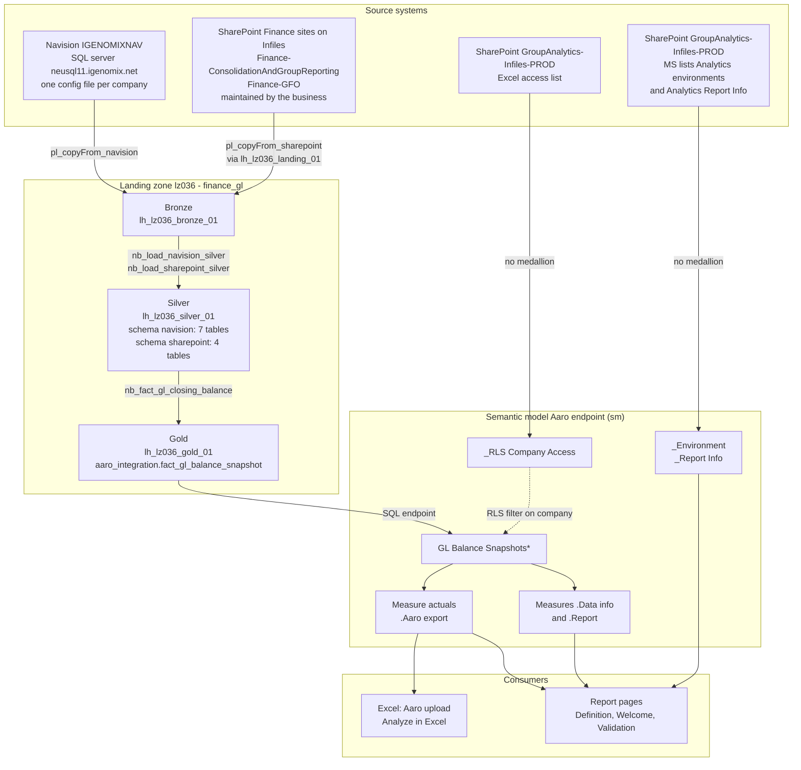

# Aaro endpoint (sm)

| | |
|---|---|
| Semantic model | `Aaro endpoint (sm)` |
| Report(s) | `Aaro endpoint (sm)` (welcome, Definition and Validation pages for the model) |
| Status | Draft |
| Version | Not released yet |
| Jira | [GA-638](https://vitrolifegroup.atlassian.net/browse/GA-638) |
| Repository | `ga_lz036`, folder `Data_models/` |
| Report info | [Analytics Report Info](https://vitrolifeglobal.sharepoint.com/sites/GroupAnalytics-Infiles-PROD/Lists/Analytics%20%20Report%20Info/AllItems.aspx), row `Aaro endpoint (sm)` |
| Excel upload file | `Example SEND RETRIEVE DIFF.xlsx` on SharePoint (name until Kristoffer Rapp has approved it; not in git). User guide: [Aaro endpoint (sm) - Excel user guide](Aaro%20endpoint%20(sm)%20-%20Excel%20user%20guide.md) |
| Last updated | 2026-11-05 by Niklas Almén |

> Draft prepared with AI assistance (Claude) from the project metadata. The owner reviews and approves it.

## Part 1 - For report users and owners

### Purpose

Finance managers (GFOs) upload their monthly actuals to Aaro with the Aaro Excel add-in.
Until now, they first extracted the data from the cube into an Excel worksheet and checked it there.
This semantic model replaces the cube extract. It gives the Aaro export from the gold layer
directly in Excel, with the same column names as the upload sheet. The GFO checks the numbers
and then uploads them with the add-in, as before.

### Business questions it answers

- What will be uploaded to Aaro for my company and this accounting period?
- Which global accounts, product areas, responsibilities and counter companies have an amount?
- Which companies and accounting periods are available to me?

### Ownership and support

| Role | Name | Responsibility |
|---|---|---|
| Business owner | Group Analytics | Approves definitions and access |
| Owner of the Aaro export solution | Kristoffer Rapp | Requirements for the Aaro export and the Excel upload file; approves the Excel file |
| Data owner (source) | Not documented yet | Source data quality (gold table `aaro_integration.fact_gl_balance_snapshot`) |
| Developer / maintainer | Niklas Almén, Group Analytics | Model and report changes |
| Support contact | servicedesk@vitrolifegroup.com (Group Analytics) | Questions and incidents; add your manager to the ticket for access |

### Who can see what

- **Audience:** the GFOs who upload actuals to Aaro.
- **How to connect:** with the Excel upload file, which reads the model with Power Query. It runs with each user's own account, so row-level security applies.
- **Access:** a user needs both Build permission on the semantic model (to connect from Excel) and a row in the Aaro access list (RLS). Request both with a ticket to servicedesk@vitrolifegroup.com, with the manager for approval.
- **Row-level security:** each user sees only the companies listed for them in the Aaro access list.
  Users who are not in the list see no data.

### How to use the report

| Page | Purpose | Main filters |
|---|---|---|
| Definition | Report info from Analytics Report Info (with the documentation link), and the measures with their definitions | Measure search |
| Welcome | Start page and landing page (the report opens here): what the model is for, which companies and accounting periods you have access to | None |
| Validation | The Aaro export table exactly as Excel gets it | Slicers: company_code, accounting_period |

### Excel upload file

The GFOs use an Excel file to fetch the Aaro export for one company and one accounting period,
check it, and upload it with the Aaro add-in. They choose the company and the accounting period from
dropdowns (only the companies they have access to), refresh, and check that the Check field shows ✓.
Next to the export, the add-in columns show SEND (what will be sent), RETRIEVE (what is in Aaro now)
and Diff (SEND minus RETRIEVE). The steps are in the
[Excel user guide](Aaro%20endpoint%20(sm)%20-%20Excel%20user%20guide.md).

### Key measures and definitions

| Measure | Business definition | Unit / currency | Notes |
|---|---|---|---|
| `actuals` | The amount that goes to Aaro for the selected company and accounting period. Balance sheet accounts are summed since the start (inception to date). P&L accounts are summed from January to the selected period. The sign is reversed for global account 2-9, as Aaro expects. | Company's own currency | Blank on totals over more than one company or accounting period. The report's export table stays empty until exactly one company and one accounting period are selected |

### Data freshness

- Refresh schedule: Not documented yet. It is set when the model is published.
- The Definition and welcome pages show the refresh status and the last refresh date.

### Warnings and things to consider (users)

- Amounts are in each company's own currency. Do not add them up across companies.
- In the report, the export table stays empty until you select exactly one company and one accounting period. In Excel, the upload file asks for one company and one accounting period. `actuals` is blank on any total over more than one company or period.
- Column names follow the Aaro upload sheet, so they look technical (for example `company_code`).
- Missing values show as empty cells, not as "(blank)".
- The gold table already sums the amounts and reverses the signs. Do not apply your own sign change in Excel.
- In the Excel upload file, always refresh (Ctrl+Alt+F5) after changing company or period, and check that the Check field shows ✓ before you upload.
- Refreshing the Excel upload file is tested in Excel desktop only, not in Excel in the browser.

## Part 2 - Technical documentation

### Architecture and lineage

| Model table | Power Query | Layer | Landing zone / workspace | Source object |
|---|---|---|---|---|
| `GL Balance Snapshots*` | `src_aaro_integration_fact_gl_balance_snapshot` | Gold | lz036, `lh_lz036_gold_01` (SQL analytics endpoint) | `aaro_integration.fact_gl_balance_snapshot` |
| `_RLS Company Access` | `src_excel_rls_gfo_aaro_access` | No medallion | SharePoint GroupAnalytics-Infiles-PROD | Excel table `tbl_rls_gfo_aaro_access` in `rls_aaro_endpoint_validation.xlsx` |
| `_Environment` | `src_sharepoint_analytics_environment` → `stg_analytics_environment` | No medallion | SharePoint GroupAnalytics-Infiles-PROD (metadata) | MS list Analytics environments |
| `_Report Info` | `src_sharepoint_analytics_report_info` | No medallion | SharePoint GroupAnalytics-Infiles-PROD (metadata) | MS list Analytics Report Info, row `Aaro endpoint (sm)` |
| `_Metric Info` | calculated | Model | - | Model metadata (`INFO.VIEW.MEASURES()`) |
| `_Helpers`, `__Metrics` | inline tables | Model | - | - |

Gold table `aaro_integration.fact_gl_balance_snapshot` (notebook `nb_fact_gl_closing_balance`) is built from these silver tables in `lh_lz036_silver_01`:

| Silver table | From bronze `lh_lz036_bronze_01` | Source |
|---|---|---|
| `navision.gl_entry`, `navision.gl_account`, `navision.customer`, `navision.vendor`, `navision.dimension_set_entry`, `navision.dimension_value` | `IGENOMIXNAV/dbo/*$<table>/` | Navision, all companies |
| `navision.aaro_accounts` | `IGENOMIXNAV/dbo/AARO Accounts/` | Navision |
| `sharepoint.companies` | `SharePoint/Finance-ConsolidationAndGroupReporting/Companies` | SharePoint Finance |
| `sharepoint.navision_product_area_map` | `SharePoint/Finance-ConsolidationAndGroupReporting/NAV_ProductArea_mapping` | SharePoint Finance |
| `sharepoint.aaro_account_dimension_requirements` | `SharePoint/Finance-ConsolidationAndGroupReporting/AARO_Account_Dimension_Requirements` | SharePoint Finance |
| `sharepoint.navision_counter_co_map` | `SharePoint/Finance-GFO/` (one folder per company) | SharePoint Finance-GFO |

| Measures (display folder) | Based on | Layer |
|---|---|---|
| `actuals` (.Aaro export) | `GL Balance Snapshots*` | Gold |
| `Export rows loaded`, `Export companies loaded`, `Accessible companies`, `Accounting period range` (.Data info) | `GL Balance Snapshots*`, filtered by RLS | Gold |
| `Selected company and accounting period`, `Label - Drillthrough selection` (.Report) | `GL Balance Snapshots*` | Gold |
| Labels, colours and dates in `_Helpers` and `_Environment` | Model and SharePoint metadata | No medallion |

The SharePoint Finance files are on the GroupAnalytics-Infiles site and are owned and updated by the business (Finance). The pipeline `pl_copyFrom_sharepoint` (configuration `finance_gl_sharepoint.yaml`) copies them to the landing lakehouse `lh_lz036_landing_01`, and `nb_promote_landing_to_bronze` moves them to bronze. The Navision tables go straight to bronze with `pl_copyFrom_navision`, one configuration file per company.

#### How the gold table is built

The notebook `nb_fact_gl_closing_balance` (`Engineering/Notebooks/20_Gold`) builds `aaro_integration.fact_gl_balance_snapshot` and overwrites it on every run:

1. Read the active rows of the 11 silver tables, and keep the GL entries of the companies in the companies list (`sharepoint.companies`).
2. Join each GL entry to its local account, the global Aaro account, the customer or vendor, and the dimensions `BUSINESS`, `BUSINESS_UNIT` and `DEPART` from the dimension set.
3. Map the counter company (customer or vendor code to the Aaro code, `navision_counter_co_map`) and the product area (business, plus business unit for business 999, `navision_product_area_map`).
4. Drop prior-year closing entries, both legs of the pair.
5. Keep product area, responsibility and counter company only for the accounts where `aaro_account_dimension_requirements` asks for them.
6. Sum per month and combination, and fill months without postings with 0, so balances carry forward.
7. Reverse the sign for global accounts starting with 2 to 9 (`actuals_reversed`).
8. Balance sheet accounts: cumulative since the first posting. P&L accounts: year to date from January.
9. Add one retained earnings row (account 2091) per company and period: the P&L up to the end of the previous year, with the same sign reversal.
10. Write the accounting period as year, month and A (for example `2610A`), with strict column types (text for the keys, double for the amounts).

The model reads `actuals_reversed` only (as a fixed decimal), and the measure `actuals` sums it.

### Environments and parameters

| Parameter | Purpose | DEV | TEST / ACC | PRD |
|---|---|---|---|---|
| `p_sql_endpoint_server_host_name` | Fabric SQL analytics endpoint of the gold lakehouse | Set (DEV endpoint) | Placeholder | Placeholder |
| `p_datawarehouse_server_host_name` | On-premises DW (only used by `_Environment`) | Placeholder | Placeholder | Placeholder |
| `p_sharepoint_site_root_path` | Infiles site for the RLS access list | PROD site | PROD site | PROD site |
| `p_sharepoint_folder_path` | Folder of the access list | `AccessRights/AaroEndpointValidation/` | same | same |
| `p_analytics_metadata_site_root_path` | Metadata site (environments, report info) | PROD site | PROD site | PROD site |
| `p_report_name`, `p_semantic_model_name` | Row in Analytics Report Info | `Aaro endpoint (sm)` | same | same |
| `p_environment_manual` | Override of the environment detection | Automatic | Automatic | Automatic |
| `p_null_member_string` | Template parameter, not used | Unknown | - | - |

- **Environment detection:** `_Environment` matches the SQL endpoint first, then the DW server, then the Infiles site.
- **Deployment:** fabric-cicd with GitHub Actions to `DEV_lz036_data_models`, `ACC_lz036_data_models` and `PRD_lz036_data_models`.
  This is the only way to publish; there is no manual publish. Since 2026-11-04, a merge to `main` deploys `Data_models/` to DEV automatically.

### Semantic model

Import mode. One fact table with no relationships, no Calendar and no dimensions (documented exception).
`discourageImplicitMeasures` is on.

| Table | Type | Grain / content | Storage mode |
|---|---|---|---|
| `GL Balance Snapshots*` | Fact (visible) | One row per company, accounting period, global account, product area, responsibility and counter company | Import |
| `_RLS Company Access` | Security (hidden) | One row per user (UPN) and company code | Import |
| `_Environment` | Helper (hidden) | One row: the connected environment | Import |
| `_Report Info` | Helper (hidden) | One row: this report in Analytics Report Info | Import |
| `_Metric Info` | Helper (hidden) | One row per visible measure | Calculated |
| `_Helpers` | Helper (hidden) | Layout measures (labels, refresh status, colours) | Import |
| `__Metrics` | Measures table (hidden, empty) | Template table; the measures are in the fact table | Import |

No relationships.

Power Query in `GL Balance Snapshots*`:
- It keeps the six key columns and `actuals_reversed`. The `_ITD` columns are left out and will be removed from gold.
- `actuals_reversed` is set to fixed decimal.
- Nulls in the key columns become empty text, so Excel shows empty cells.

### Measures (technical)

| Display folder | Measure | Logic |
|---|---|---|
| `.Aaro export` | `actuals` | `SUM` of `Actuals reversed` when the current row or total has exactly one `company_code` and one `accounting_period` (`HASONEVALUE`, no `ALLSELECTED`), otherwise blank. Works for the report and for the Excel upload file, where Power Query reads the model without a native DAX query |
| `.Report` | `Is one company and period selected` | 1 when `ALLSELECTED` has exactly one `company_code` and one `accounting_period`, otherwise 0. Visual-level filter (= 1) on the export table on the Validation page |
| `.Report` | `Selected company and accounting period` | Text of the selected company and accounting period, or a prompt to select them |
| `.Report` | `Label - Drillthrough selection` | One line with the selection of each key column |
| `.Data info` | `Export rows loaded`, `Export companies loaded`, `Accessible companies`, `Accounting period range` | Counts and ranges with `REMOVEFILTERS`, still limited by RLS |
| `_Helpers` | Footer labels, refresh status, `_cf_` colours, instructions | Template layout measures |

### Excel upload file (technical)

The file lives on SharePoint, not in git. It reads the model through the workspace XMLA endpoint
(`powerbi://api.powerbi.com/v1.0/myorg/DEV_lz036_data_models`) with Power Query, as the signed-in user.

| Part | Content |
|---|---|
| Query `Output` | The cube of `Aaro endpoint (sm)`: the six key columns of `GL Balance Snapshots*`, a filter on `p_company` and `p_period`, **then** the measure `actuals`. The filter must come before the measure is added. Loaded as an Excel table on the sheet `Aaro_Upload`. |
| Queries `List company`, `List period` | Distinct `company_code` and `accounting_period` (limited by RLS), on the hidden sheet `Lists`, as the tables `tbl_list_company` and `tbl_list_period` |
| Names | `p_company` = `Aaro_Upload!$C$2`, `p_period` = `Aaro_Upload!$C$3` (read by `Output`); `lst_company` and `lst_period` = the list tables (data validation lists for C2 and C3) |
| Add-in columns | `SEND formula`, `RETRIEVE formula` and `Diff` (SEND minus RETRIEVE) are Aaro add-in formulas next to `actuals`. Keep them inside the `Output` table so they fill down on every refresh. |
| Check field | A `LET` formula in B4 compares every row of `Output` with `p_company` and `p_period`: ✓ when all rows match, ⚠ when the selection changed after the last refresh, "No data" when the table is empty. Conditional formatting colours it. |
| Protection | Workbook structure is protected (`Lists` stays hidden). The sheet with `Output` is not sheet-protected, because Excel can't refresh a query table on a protected sheet. |

Why it is built this way:

- **No native DAX query.** A DAX query in Power Query asks for approval ("native database query")
  every time the company or period changes. The cube path doesn't.
- **`actuals` uses `HASONEVALUE`, not `ALLSELECTED`.** A Power Query filter is not a selection, so the
  earlier `ALLSELECTED` version returned blank in Excel. See [Measures (technical)](#measures-technical).
- **Hidden columns can't be read.** Power Query only sees visible columns and measures, so
  `Actuals reversed` stays hidden and Excel uses the measure.

Moving the file to PRD:

1. Change the server address in all three queries (`Output`, `List company`, `List period`).
2. Give the users Build permission on the semantic model (Viewers can't connect without it).
3. Remove the DEV label in the file.

### Security

- **Role:** `Company access`, dynamic RLS.
- **`_RLS Company Access`:** filtered to `LOWER( USERPRINCIPALNAME( ) )`.
- **`GL Balance Snapshots*`:** filtered to the user's company codes. Company code `ALL` gives all companies.
- **Access list:** maintained by hand in `rls_aaro_endpoint_validation.xlsx` on Infiles PROD. It is the same file as Aaro endpoint validation v2.
- **To confirm:** keep sharing this file or give the model its own access list. This is a decision for the PR reviewer.
- **Members:** assign one Entra group with all users to the role in the Power BI service.
- **Not restricted by RLS:** workspace Admins, Members and Contributors see all data.
- **Testing:** test with "View as" before release. Not documented yet.

### Data quality and validation

- **Gold table logic:** confirmed by Rafael Llopis Garijo (lz036 engineering) in Teams on 2026-10-14. The table is already summed (balance sheet inception to date, P&L year to date), and the sign is reversed for Aaro accounts 2 and higher. `actuals_reversed` is the column that matches Aaro.
- **Business validation:** comparing with an Aaro upload or a GFO worksheet is not done yet.
- **Excel upload file:** works in Excel desktop (tested by Group Analytics on 2026-11-05: dropdowns, refresh, Check field). To be validated by Kristoffer Rapp (owner of the Aaro export solution) and Hanna Sofia (Head of Analytics). The Aaro add-in columns (SEND, RETRIEVE, Diff) still need a test by a user with the add-in. Excel in the browser is not tested.
- **Technical validation:** the model check is clean, and all report fields resolve. Checked in Power BI Desktop (Validation page) and in Excel desktop (upload file) on 2026-11-05.

### Best practice review

| Area | Result | Details |
|---|---|---|
| BPA rules (ga-model-review) | 0 blocking, 0 warnings, 30 ignored by annotation | Python model check, 2026-11-04 (run again after the documentation link fix, same result), plus a manual review of the standards without a BPA rule |
| Report design (ga-report-design) | Fixed, 1 exception | 2026-11-04: Validation slicers no longer overlap the environment card, export table column widths, Definition tab order in reading order, drill-through text removed (there is no drill-through page) |
| Release checklist (ga-release-checklist) | In progress | See the pull request |
| Documented exceptions | 5 | See below |

Documented exceptions (`STD_DOCUMENT_EXCEPTIONS`):

| Rule / standard | Objects | Reason |
|---|---|---|
| `GA_MODEL_DATE_TABLE_MARKED`, `STD_STAR_SCHEMA_DEFAULT`, `STD_SINGLE_DATE_DIMENSION` | Model | The model is a 1:1 export table for the Aaro Excel upload. Excel uses the columns directly; a Calendar or dimensions would add nothing. |
| `NC_FIELD_SENTENCE_CASE` | `company_code`, `accounting_period`, `gl_global_account_no`, `product_area_no`, `responsibility_no`, `counter_company`, measure `actuals` | The names must match the Aaro upload sheet. |
| `GA_HIDDEN_UNUSED_COLUMNS_REVIEW`, measures outside `__Metrics` | `__Metrics[Dummy]`, `_Helpers[Dummy]`; measures in `GL Balance Snapshots*` | Only the fact table is visible in Excel, so the measures are next to the columns. The dummy columns are template placeholders. |
| `GA_HIDDEN_UNUSED_COLUMNS_REVIEW` | 20 hidden columns in `_Environment`, `_Metric Info` and `_Report Info` | Everything except `GL Balance Snapshots*` is hidden, so Excel users see only the export table. These columns are used by the report pages (Definition, environment card), not by DAX. |
| `STD_REPORT_APPROVED_THEME` (no per-visual colours) | Page navigator; filter pane buttons, Measure slicer and Data model description matrix (`#F5F5F5`) | Copied from the template and Aaro endpoint validation v2. The Vitrolife theme has no values for these visuals yet; they move into the theme in the planned theme rework. |

### Warnings and things to consider (maintainers)

- **Hand-maintained dependencies:**
  - The RLS access list, an Excel file on Infiles PROD (shared with Aaro endpoint validation v2).
  - The row `Aaro endpoint (sm)` in Analytics Report Info.
  - The Finance mapping files on Infiles (companies, product area map, Aaro account dimension requirements, counter company map per company), owned and updated by the business. A wrong or late update changes the Aaro export.
- **Placeholder parameters:** the TEST/ACC/PRD values of `p_sql_endpoint_server_host_name` must be set before those environments are used.
- **Gold columns:** the notebook now writes `actuals` and `actuals_reversed`; the earlier `_ITD` columns are gone from it. The comment in the Power Query step of `GL Balance Snapshots*` still mentions `_ITD` and can be updated at the next model change.

### Operations

- Refresh schedule: Not documented yet.
- Credentials: a service account for the SQL endpoint and SharePoint, confirmed at publish (`CHK_PLATFORM_SERVICE_ACCOUNTS`).
- When a refresh fails: create a ticket at servicedesk@vitrolifegroup.com for Group Analytics.
- Publishing the documentation: export this file as PDF, upload it to the Group Analytics SharePoint folder, and paste the link into the `Documentation link` column of Analytics Report Info.

### Change log

| Date | Version | Change | Jira | By |
|---|---|---|---|---|
| 2026-11-04 | Draft | First version: model, report pages, RLS, Report Info from the MS list with documentation link | GA-638 | Niklas Almén |
| 2026-11-04 | Draft | Documentation link works when SharePoint returns a relative link; report review fixes (Validation slicers, column widths, tab order); 2 report exceptions documented | GA-638 | Niklas Almén |
| 2026-11-05 | Draft | Start page renamed to Welcome and placed after Definition, page navigator sized to its two pages; the start-page exception is removed because a semantic model only now opens on its Welcome page by standard (`STD_REPORT_LANDING_AND_START_PAGE`) | GA-638 | Niklas Almén |
| 2026-11-05 | Draft | Deployment: merges to `main` deploy to DEV automatically since 2026-11-04; the deployment-gap and old-branch warnings are removed | GA-638 | Niklas Almén |
| 2026-11-05 | Draft | High-level lineage diagram (Mermaid) and lineage tables: source systems, lz036 bronze, silver and gold, model tables and measures | GA-638 | Niklas Almén |
| 2026-11-05 | Draft | How the gold table is built (notebook nb_fact_gl_closing_balance, step by step); SharePoint files to bronze documented (pl_copyFrom_sharepoint via the landing lakehouse); gold columns warning updated | GA-638 | Niklas Almén |
| 2026-11-05 | Draft | `actuals` checks the current row instead of `ALLSELECTED`, so the Excel upload file can read it with Power Query (no native query prompt); new measure `Is one company and period selected` keeps the export table empty until a selection is made | GA-638 | Niklas Almén |
| 2026-11-05 | Draft | Excel upload file documented: Power Query against the model (no native query), dropdowns limited by RLS, Check field, PRD steps; Excel user guide for the GFOs; Kristoffer Rapp added as owner of the Aaro export solution | GA-638 | Niklas Almén |
